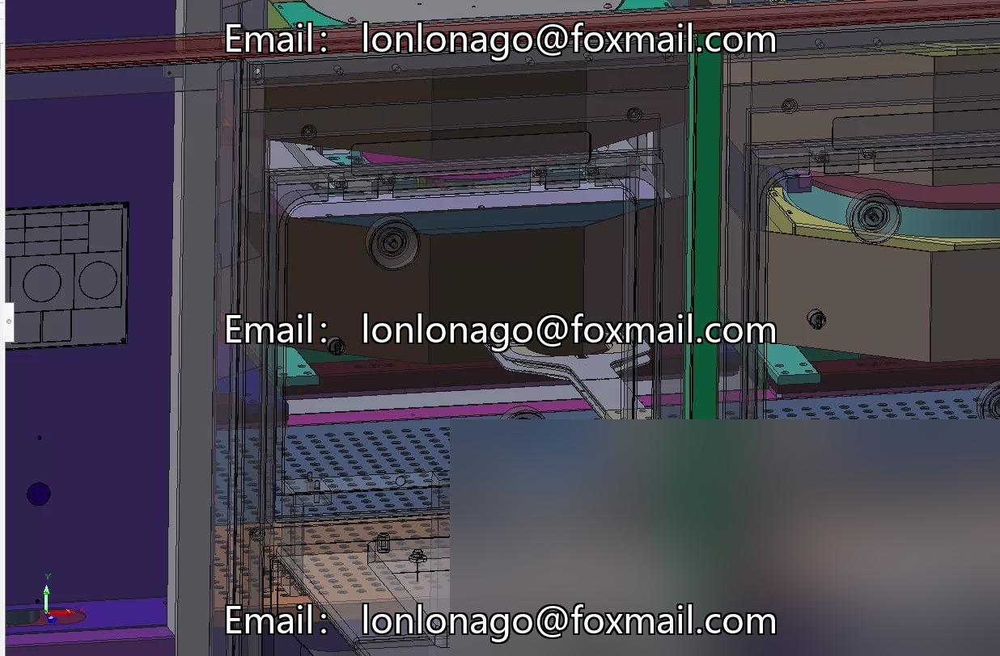
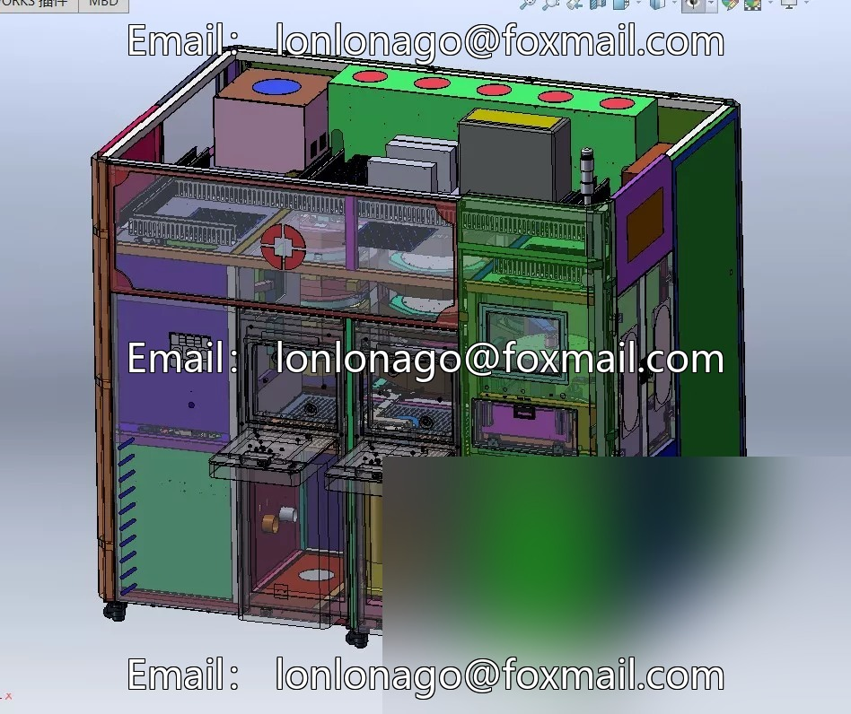
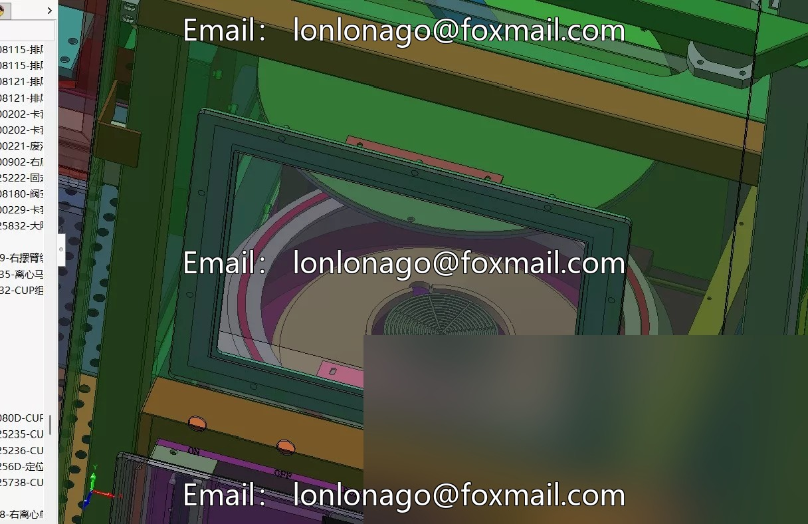
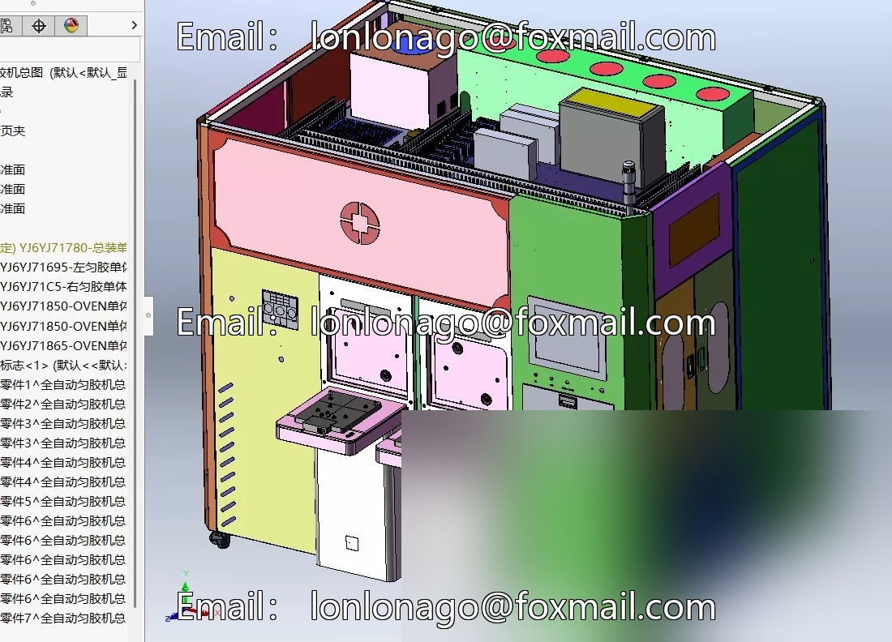

# Symmetric clear-thread acid developer 3D drawing SW design complete and clear

## Body

Automatic UV developer 3D drawing SW design is a core equipment of the semiconductor industry, complete and clear, one of the automatic UV developer 3D drawings, SW design, including neutral format. The drawing is complete with clear details.
are copyable, refunds after sale!

The SW design for the 3D drawings of a homogenizationdeveloper machine presents a complete and clear picture, relevant to the semiconductor industry, with various layout, model and drawing identifiers.

<!-- AI_ENRICHED -->

## Images

## Payment

Here is a pay link on Stripe ( https://buy.stripe.com/3cs8yP7sY87d0vu9AB ). Please contact me lonlonago@foxmail.com after funding $89, and I will send you a complete data files , thank you!

